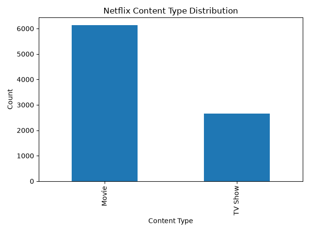
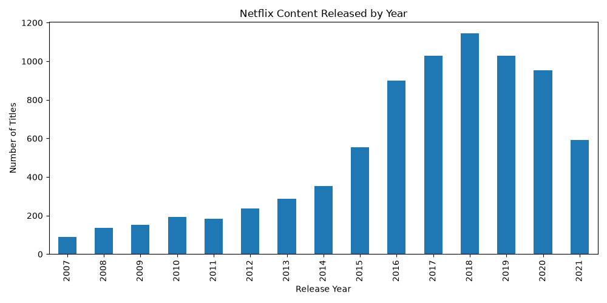
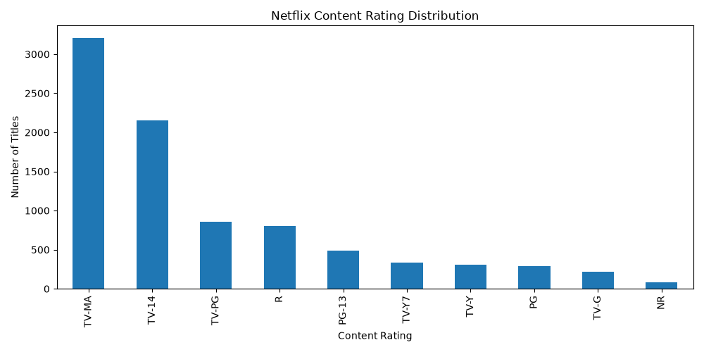
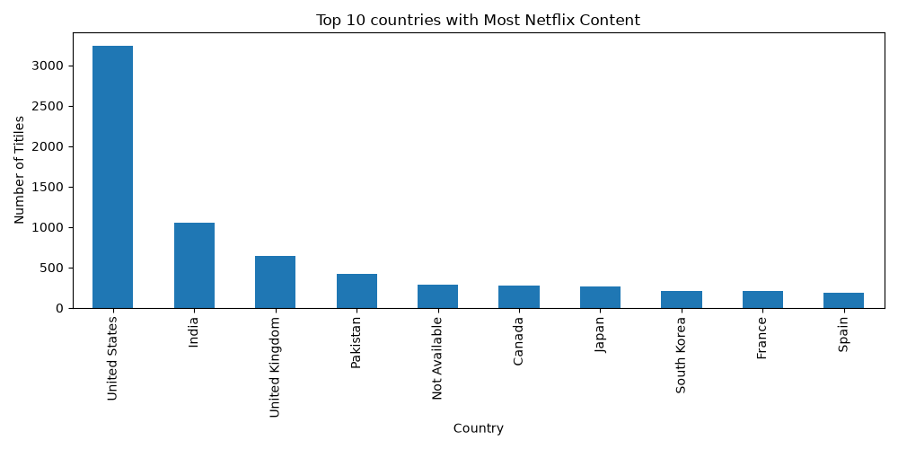
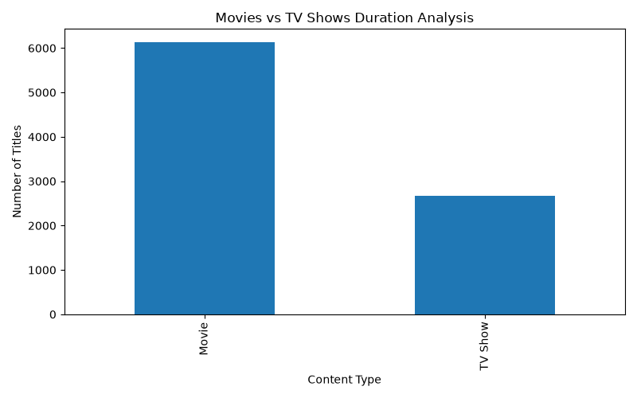
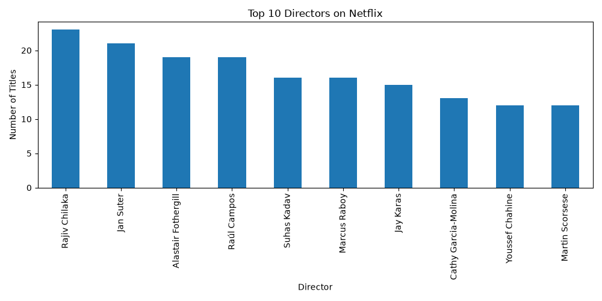

#Netflix Data Analysis Project#

#Project Overview

This project performs Exploratory Data Analysis (EDA) on Netflix Movies and TV Shows data using Python. The objective is to identify patterns and trends in Netflix content.

#Tools & Technologies

- Python
- Pandas
- Matplotlib
- VS Code
- Seaborn
- Numpy

#Dataset

Netflix Movies and TV Shows dataset ("netflix_titles.csv").

#Analysis Performed

1. Content Type Distribution
2. Content Released Per Year
3. Content Rating Distribution
4. Top 10 Countries with Most Netflix Content
5. Movies vs TV Shows Analysis
6. Top 10 Directors on Netflix

#Key Insights

- Movies are more numerous than TV Shows.
- Netflix content increased significantly between 2015 and 2019.
- The United States has the highest number of titles.
- TV-MA is the most common content rating.
- Rajiv Chilaka is among the top directors by title count.

#Conclusion

This project helped explore Netflix content trends and develop practical skills in data cleaning, data analysis, and data visualization using Python.

#Author

Shrutika Sanjay Thorat

Aspiring Data Analyst

## Project Visualizations

### 1. Content Type Distribution

### 2. Release Year Distribution

### 3. Rating Distribution

### 4. Top 10 Countries

### 5. Movies vs TV Shows

### 6. Top Directors

